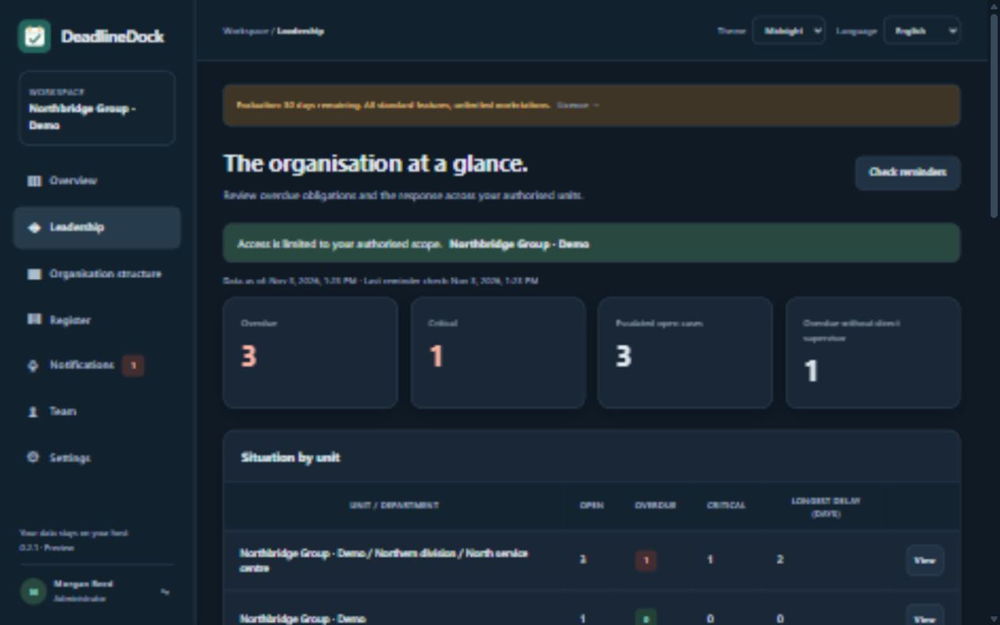

# DeadlineDock

**Documents. Deadlines. Accountability.**

A Windows application for tracking organisational documents, important dates and
the people responsible for them. Department hierarchy, overdue escalation and
role-based leadership dashboards, with your data on your own host.

## Download 0.2.1

- [Windows x64 installer](https://github.com/Grimegod/DeadlineDock/releases/download/v0.2.1/DeadlineDock-0.2.1-Setup-x64.exe)
- [Portable ZIP](https://github.com/Grimegod/DeadlineDock/releases/download/v0.2.1/DeadlineDock-0.2.1-win-x64.zip)
- [All releases and SHA256 checksums](https://github.com/Grimegod/DeadlineDock/releases)

Windows 10/11 x64. Self-contained: no separate .NET installation required.
This is an unsigned preview for a controlled pilot.

## Features

- Documents/deadlines with responsible person, deputy, attachments and history.
- Units/departments, assigned supervisors and five roles with scoped access.
- Configurable overdue escalation and critical-case routing along the hierarchy.
- Leadership dashboard with overdue cases, recorded blockers and acknowledgement.
- CSV import/export, verified backup/restore and preservation of existing records.
- Midnight, Forest and warm Sand themes, with a saved per-browser choice.
- English default plus Romanian, Spanish, French, German, Portuguese, Italian,
  Simplified Chinese, Japanese, Arabic and Hindi.

## Organisation licence

**Maximum EUR 10, one payment per organisation, unlimited internal workstations
and users.** Permanent use of the purchased major version. A full 30-day
evaluation is included; afterwards reading, CSV export and backup remain available.
Request a signed offline licence from **FFFNewsNow@gmail.com**. Online checkout
is not configured. See [licence terms](LICENSE.txt).

## Get started

Install, open DeadlineDock and create your organisation/administrator with your
own password. Configure units, account roles and supervisors under Organisation
structure and Team. Keep the host running for in-app reminders. Shared access
requires one central HTTPS host; separate installations do not synchronise.

- [User guide](USER-GUIDE.md)
- [Units, roles and escalation](HIERARCHY-AND-ALERTS.md)
- [Network deployment](DEPLOYMENT.md)
- [Release notes](RELEASE-NOTES.md)

## Scope and feedback

No email/SMS, SSO, automatic recurring deadlines or military/regulatory
accreditation is included. Pilot your workload before a larger deployment.
Report ordinary bugs through Issues without attaching private organisation data.
For security concerns, contact the publisher privately; see [SECURITY.md](SECURITY.md).

This repository contains public documentation and download releases only.
The original application source and licence-signing key remain private.
Third-party notices accompany the distributed application.

Contact: **FFFNewsNow@gmail.com**
